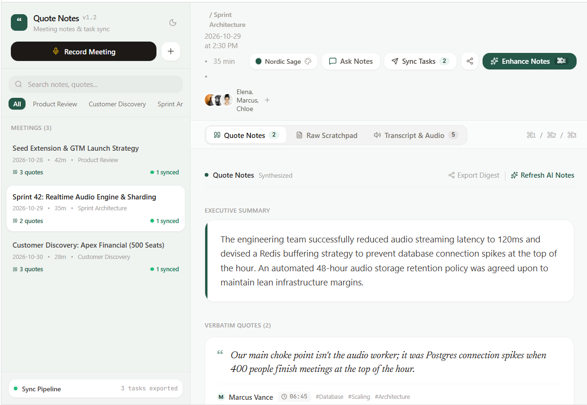

# Quote Notes

A meeting notetaking tool built around verbatim attribution. It keeps what people
actually said, with a name and a timestamp on it, instead of replacing the meeting
with a summary nobody can check.



## The idea

Most AI notetakers hand you a paragraph of synthesis and throw the transcript
away behind a tab you never open. When someone later asks "who agreed to that",
the summary cannot answer, because a summary is the tool's words, not the room's.

Quote Notes treats the transcript as the source of record. The synthesis sits on
top of it and every claim in the synthesis points back down. A quote card carries
the exact sentence, the speaker, the timestamp, and why it mattered. Click the
timestamp and the transcript jumps there.

There are three panes over the same meeting, and you can switch between them:

| Pane | What it holds |
| --- | --- |
| Quote Notes | Executive summary, thematic takeaways, verbatim quote cards, action items |
| Raw Scratchpad | What you typed yourself during the meeting, untouched |
| Transcript & Audio | The full timestamped transcript |

The scratchpad is kept separate on purpose. Your own notes are evidence of what
you thought was important, and the model should enrich them rather than overwrite
them.

## Architecture

An Express server (`server.ts`) runs Vite in middleware mode in development and
serves `dist/` in production. React 19 and Tailwind 4 on the front end. Meetings
persist to `localStorage` under `quotenotes_meetings`.

### Three endpoints

**`POST /api/enhance-meeting`** takes the raw scratchpad, the transcript, the
participants and the meeting template, and returns structured JSON: executive
summary, categorised takeaways, verbatim quotes, action items, and a drafted
follow-up email. It calls Gemini with `responseMimeType: 'application/json'` and
temperature 0.2, under a system instruction that tells it to preserve the user's
voice and pull quotes verbatim rather than paraphrase.

**`POST /api/chat-meeting`** answers a question against one meeting's transcript
and notes, instructed to cite exact words with speaker and timestamp.

**`POST /api/sync-tasks`** turns action items into tickets for Linear, Notion,
Asana, Jira or Slack.

### The fallback matters

If `GEMINI_API_KEY` is unset, or the API call fails, `generateFallbackEnhancement`
synthesises the same JSON shape locally from the transcript and raw notes. The
client cannot tell the difference and the app stays usable.

This is deliberate. A notetaking tool that breaks when an API is down is worse
than one that degrades, because the meeting is happening either way and you only
get one pass at it.

### Capture

`AudioRecorder.tsx` uses `getUserMedia` for the microphone and the Web Speech API
(`SpeechRecognition` / `webkitSpeechRecognition`) for live transcription, so
capture depends on browser support. There is also a scripted dialogue simulator
that feeds fixed phrases on a timer, for working on the app without talking into
a microphone.

## Running it

```bash
npm install
npm run dev
```

Opens on port 3000. Copy `.env.example` and set `GEMINI_API_KEY` to get the real
model. Without it the local synthesiser runs instead.

`npm run lint` runs `tsc --noEmit`, which is the only automated check in the repo.

## Honest status

This is a working build, not a shipped product.

- **The sample meetings are fictional.** `src/data/sampleMeetings.ts` contains
  invented people and invented companies. No real meeting, client or recording is
  in this repository.
- **Task sync is simulated.** `/api/sync-tasks` generates plausible identifiers
  and URLs and returns success. It does not authenticate against Linear, Notion,
  Asana, Jira or Slack, and nothing is created in any of them. The integration is
  designed, not built.
- **Transcription is browser-dependent.** The Web Speech API is not in every
  browser and accuracy varies. There is no server-side transcription.
- **No audio is stored.** The UI shows a retention policy; there is no storage
  layer behind it.
- **`localStorage` is the only persistence.** No accounts, no sync across devices.
  Clearing site data clears the meetings.
- **No tests.**

## Licence

No licence is granted. This repository is published so the architecture can be
read, not reused.
